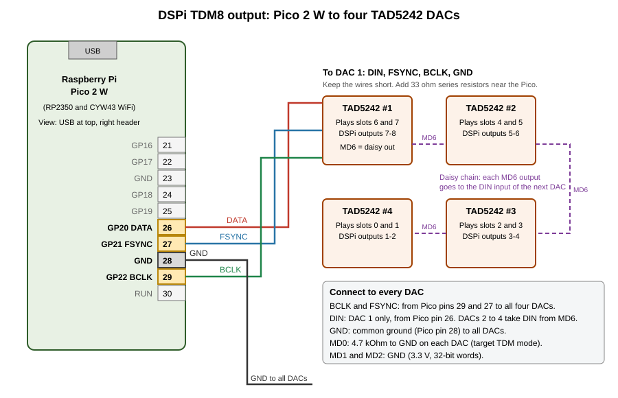

# TDM8 Output Guide

This guide tells you how to connect the DSPi to TAD5242 DACs with the TDM8 output.
It also tells you how to turn the output on.

The TDM8 output is for the RP2350 only. This includes the Pico 2 and the Pico 2 W.

## 1. What TDM8 does

TDM8 sends all 8 output channels on one data wire.
The DSPi sends the channels as 8 time slots in each audio frame.

| Item | Value |
|---|---|
| Channels | 8 (DSPi outputs 1 to 8) |
| Slot size | 32 bits |
| Sample size | 24 bits, MSB first, 8 zero bits after |
| Bit clock (BCLK) | 256 times the sample rate |
| Frame sync (FSYNC) | 1 BCLK pulse at the start of slot 0 |
| First data bit | Same BCLK cycle as the FSYNC pulse |
| Sample rates | 44.1 kHz and 48 kHz only |
| Logic level | 3.3 V |

At 48 kHz, BCLK is 12.288 MHz.
The DSPi changes DATA and FSYNC on the rising edge of BCLK.
The DAC reads them on the falling edge.

Above 48 kHz, the output stops. It starts again when the rate returns to 48 kHz or lower.

## 2. Pin connections

The default pins are in the table.
You can change them with the `REQ_SET_TDM_PINS` command.

| Signal | Pico GPIO | Pico pin | Connect to |
|---|---|---|---|
| DATA | GP20 | 26 | DIN of DAC 1 |
| FSYNC | GP21 | 27 | FSYNC of all DACs |
| BCLK | GP22 | 29 | BCLK of all DACs |
| GND | GND | 28 | GND of all DACs |

FSYNC always uses the GPIO number after DATA.
If you set DATA to GP20, FSYNC is GP21.

Do not use these GPIOs for TDM8 on a Pico 2 W: GP23, GP24, GP25 and GP29.
The WiFi chip uses them.

## 3. Connect the TAD5242 DACs

Each TAD5242 has two output channels.
Use four DACs for eight channels.

The daisy chain works as follows:

1. DAC 1 receives all 8 slots on DIN.
2. DAC 1 plays the last 2 slots.
3. DAC 1 sends the other slots to the next DAC on its MD6 pin.
4. Each next DAC does the same.

| DAC | Receives DIN from | Plays DSPi outputs |
|---|---|---|
| 1 | Pico DATA | 7 and 8 |
| 2 | MD6 of DAC 1 | 5 and 6 |
| 3 | MD6 of DAC 2 | 3 and 4 |
| 4 | MD6 of DAC 3 | 1 and 2 |

Connect each DAC as follows:

1. Connect BCLK to the Pico BCLK signal.
2. Connect FSYNC to the Pico FSYNC signal.
3. Connect GND to the common ground.
4. Connect a 4.7 kOhm resistor from MD0 to GND. This sets target TDM mode.
5. Connect MD1 and MD2 to GND. This sets 3.3 V operation and 32-bit words.

Use short wires.
Put a 33 Ohm resistor in series with each signal near the Pico.
This is a suggestion. It is not a requirement from the datasheet.

Refer to the TAD5242 datasheet (SLASF31A) for the analog outputs, the power supply and the other MD pins.
This guide does not cover them.

## 4. Turn on the TDM8 output

The TDM8 output and the ADAT output share one engine.
Only one of them can run at a time.
Use vendor control requests to set it up.

| Step | Request | wValue | Result |
|---|---|---|---|
| 1 | `0xCF` (set bulk format) | `1` | Selects TDM8 |
| 2 | `0x81` (set TDM pins) | `(BCLK << 8) \| DATA` | Optional. Sets other pins. `0xFF` selects the default. |
| 3 | `0xCA` (set bulk enable) | `1` | Starts the output |

Each request returns one status byte.
`0x00` means success.
`0x01` means the pin is not valid.
`0x02` means another function uses the pin.
`0x05` means a value is not valid.

To read the settings:

- `0x80` returns the format (0 = ADAT, 1 = TDM8).
- `0x82` returns two bytes: DATA pin, then BCLK pin.
- `0xCE` returns the output status.

To stop the output, send `0xCA` with wValue `0`.

## 5. Limits

- The settings are not saved to flash. After a restart, the output is off and the format is ADAT.
- You cannot use the ADAT output and the TDM8 output at the same time.
- FLAC streaming over WiFi does not work while the bulk output is on. See the WiFi streaming guide.
- This firmware was built but not tested on hardware.
