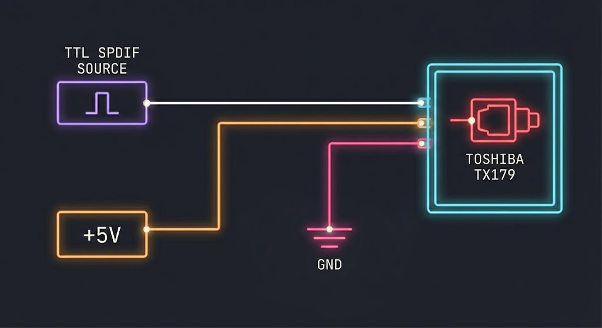
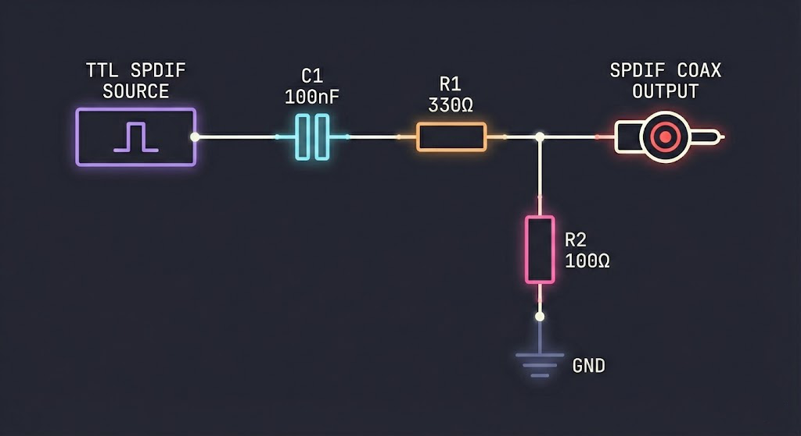

# DSPi Firmware

**DSPi** transforms a Raspberry Pi Pico or other RP2040/RP2350-based board into a very competent and inexpensive little digital audio processor. It acts as a USB sound card with an onboard DSP engine, allowing you to make use of essential tools like room correction, active crossovers, parametric EQ, time alignment, loudness compensation, headphone crossfeed, limiting and bass enhancement.

It is my hope that the RP2040 and RP2350 will garner a reputation as the "swiss army knife of audio for less than a cup of coffee".

Feel free to join the [official Discord server](https://discord.gg/RCyqxAQ5xS) for development updates, discussion or to request assistance!

---

## Table of Contents

- [Key Capabilities](#key-capabilities)
- [Platform Support](#platform-support)
- [Audio Signal Chain](#audio-signal-chain)
- [Hardware Setup](#hardware-setup)
- [Inputs](#inputs)
- [Outputs](#outputs)
- [DSP Features](#dsp-features)
  - [Matrix Mixer](#matrix-mixer)
  - [Parametric Equalization](#parametric-equalization)
  - [Crossover Filters](#crossover-filters)
  - [Per-Input Preamp](#per-input-preamp)
  - [Volume Leveller](#volume-leveller)
  - [Stereo Upmixer (RP2350)](#stereo-upmixer-rp2350)
  - [Headphone Crossfeed](#headphone-crossfeed)
  - [Subharmonic Synthesizer](#subharmonic-synthesizer)
  - [Psychoacoustic Bass](#psychoacoustic-bass)
  - [Tube Preamp Emulation](#tube-preamp-emulation)
  - [Loudness Compensation](#loudness-compensation)
  - [Output Limiter](#output-limiter)
  - [Volume Controls](#volume-controls)
  - [Spectrum Analyser](#spectrum-analyser)
  - [Signal Generator](#signal-generator)
- [Control Surfaces](#control-surfaces)
- [User Presets](#user-presets)
- [Developer Reference](#developer-reference)
  - [System Architecture](#system-architecture)
  - [Performance Tuning](#performance-tuning)
  - [Control Interfaces](#control-interfaces)
  - [System Telemetry](#system-telemetry)
  - [Runtime Pin Configuration](#runtime-pin-configuration)
  - [USB Audio Loopback Capture (DSPI_LOOPBACK)](#usb-audio-loopback-capture-dspi_loopback)
- [Building from Source](#building-from-source)
- [Detailed Specifications](#detailed-specifications)
- [License](#license)

---

## Key Capabilities

*   **USB Audio Interface:** Plug-and-play under macOS, Windows, Linux, and iOS. Stereo 16-bit and 24-bit PCM at 44.1, 48, and 96 kHz. The RP2350 also offers 4, 6, and 8-channel modes at 48 kHz.
*   **Multiple Inputs:** Up to four selectable S/PDIF inputs, I2S input (DSPi as clock master, or slaved to an external master), and 8-channel ADAT lightpipe input on RP2350. LG Sound Sync volume and mute can optionally drive the DSPi volume.
*   **24-bit S/PDIF or I2S Outputs:** Up to four independent stereo output slots (8 channels on RP2350, 4 on RP2040). Each slot can be switched at runtime between S/PDIF and I2S. I2S slots share a common BCK/LRCLK and can optionally produce a 128× or 256× master clock. All slots stay sample-aligned with each other.
*   **ADAT Output (RP2350):** An 8-channel lightpipe output that mirrors outputs 1-8.
*   **Subwoofer PDM Output:** A dedicated mono delta-sigma output that can drive a subwoofer amplifier through a simple RC filter, with no second DAC needed.
*   **Unified Channel Model:** Every input is a first-class channel with its own preamp, 10-band PEQ and meter. Every output has its own PEQ, crossovers, gain, mute, delay, and limiter.
*   **Matrix Mixer:** Route any input to any output with per-crosspoint gain and phase invert. 8x9 on RP2350, 2x5 on RP2040.
*   **Parametric Equalization:** 10 PEQ bands per channel with 13 filter types, including first-order shelves and the Linkwitz Transform. 170 bands in total on RP2350 and 70 on RP2040. The RP2350 uses a hybrid SVF/biquad design for better low-frequency accuracy.
*   **Active Crossovers:** 4 crossover filters per output: Linkwitz-Riley, Butterworth, and Bessel low/high-pass up to 8th order (48 dB/oct).
*   **Bass Enhancement:** A dbx-style subharmonic synthesizer and a psychoacoustic "missing fundamental" bass enhancer, each selectable per output.
*   **Tube Preamp Emulation:** 16 modelled tube types with rectifier sag and output transformer, per output.
*   **Output Limiter:** A brickwall lookahead peak limiter on every output, with link groups.
*   **Volume Leveller:** An RMS upward compressor that lifts quiet content toward a target level without amplifying loud passages.
*   **Loudness Compensation:** Volume-dependent EQ based on ISO 226:2003, selectable per output.
*   **Headphone Crossfeed:** BS2B-based crossfeed with interaural time delay, selectable per output pair.
*   **Stereo Upmixer (RP2350):** Derives centre and surround channels from a stereo source.
*   **Time Alignment:** Per-output delay of up to 42 ms on RP2350 and 21 ms on RP2040 (at 48 kHz).
*   **Selectable Output Latency:** From 0.67 ms to 8 ms, trading latency against tolerance of host timing jitter.
*   **Spectrum Analyser and Signal Generator:** A built-in third-octave RTA on any input or output, and a 15-type test signal generator for setup and measurement.
*   **Control Surfaces:** Wire your own buttons, encoders, pots, LEDs, IR remote, and character or OLED displays directly to spare GPIOs.
*   **External Control:** Besides the USB vendor interface, DSPi can be controlled over UART or I2C by a microcontroller, such as a front-panel board.
*   **Configurable Pins:** Every output, input, and clock pin can be reassigned at runtime to suit custom PCB layouts, with no reflashing required.
*   **10-Slot Preset System:** Save, load, and name up to 10 complete configurations. Preset switches fade to silence first, so they don't pop.
*   **Diagnostics:** Per-channel peak/clip metering, CPU load per core, USB error counters, output ring health, S/PDIF input rate, clock trim, and temperature.
*   **Firmware Update via USB:** A vendor command reboots the device into the UF2 bootloader, so the host app can push new firmware without a BOOTSEL press.

---

## Platform Support

| Feature | RP2040 (Pico) | RP2350 (Pico 2) |
|---------|---------------|-----------------|
| **System Clock** | 307.2 MHz (overclock) | 307.2 MHz |
| **Core Voltage** | 1.15 V | 1.15 V |
| **Sample Rates** | 44.1 / 48 / 96 kHz | 44.1 / 48 / 96 kHz |
| **Audio Processing** | Q28 fixed-point | Single-precision float |
| **Channels** | 7 (2 inputs + 5 outputs) | 17 (8 inputs + 9 outputs) |
| **USB Input** | Stereo | Stereo, plus 4/6/8 channels at 48 kHz |
| **S/PDIF Inputs** | 4 selectable | 4 selectable |
| **I2S Input** | Stereo, master or slave | Up to 8 channels, master or slave |
| **ADAT Input / Output** | No | 8 channels each |
| **Output Slots** | 2 stereo (each S/PDIF or I2S) | 4 stereo (each S/PDIF or I2S) |
| **Output Bit Depth** | 24-bit | 24-bit |
| **PDM Output** | 1 (subwoofer) | 1 (subwoofer) |
| **Matrix Mixer** | 2x5 | 8x9 |
| **PEQ Bands** | 10 per channel (70 total) | 10 per channel (170 total) |
| **Crossover Bands** | 4 per output | 4 per output |
| **Max Delay** | 1023 samples (21 ms at 48 kHz) | 2047 samples (42 ms at 48 kHz) |
| **Stereo Upmixer** | No | Yes |
| **Math Engine** | Hand-optimized ARM assembly | Hardware FPU (hybrid SVF/biquad EQ) |
| **Dual-Core EQ** | Yes (Core 1 processes outputs 3-4) | Yes (Core 1 processes outputs 3-8) |
| **User Presets** | 10 slots | 10 slots |

Both platforms run at 307.2 MHz at 1.15 V. The clock is fixed, with no rate-dependent switching, and the audio clock dividers are integer at every supported sample rate. When DSPi follows an external clock (S/PDIF, ADAT, or I2S slave input), it trims the system PLL by a few ppm to track the source rather than resampling. The RP2350 has much more processing headroom thanks to its hardware floating-point unit, which is why it gets more channels, the upmixer, and the hybrid SVF/biquad filters.

---

## Audio Signal Chain

DSPi processes audio in a linear, low-latency pipeline. The order is the same on both platforms, except that the upmixer exists only on RP2350.

```
Input:  USB (stereo 16/24-bit at 44.1/48/96 kHz; RP2350 also 4/6/8 ch at 48 kHz)
        or S/PDIF 1-4, I2S (master or slave), ADAT (RP2350)
    |
PASS 1    Per-input preamp
    |
PASS 2    Input PEQ (10 bands per input) -> input meters / RTA input tap
    |
PASS 2.5  Volume Leveller (optional)
    |
PASS 4    Matrix Mixer (2x5 on RP2040, 8x9 on RP2350)
          Upmixer injection (RP2350 only, optional)
          Signal generator injection (when active)
    |
PASS 4.5  Headphone Crossfeed (per output pair, optional)
    |
PASS 5    Per output:
            Subharmonic Synth -> Psychoacoustic Bass -> Tube Preamp
            -> Crossover -> Output PEQ
            -> Output Gain x User Volume x Master Volume (and mute)
            -> Loudness Compensation -> Limiter -> Delay
            -> output meters / RTA output tap
    |
    +-- Out 1-2 --> S/PDIF or I2S slot 0 (data: GPIO 6 default)
    +-- Out 3-4 --> S/PDIF or I2S slot 1 (data: GPIO 7 default)
    +-- Out 5-6 --> S/PDIF or I2S slot 2 (data: GPIO 8 default, RP2350)
    +-- Out 7-8 --> S/PDIF or I2S slot 3 (data: GPIO 9 default, RP2350)
    +-- Out 1-8 --> ADAT output mirror    (data: GPIO 12 default, RP2350)
    +-- Sub     --> PDM                   (data: GPIO 10 default; Out 9 on RP2350, Out 5 on RP2040)
```

The subharmonic synth, psychoacoustic bass, tube preamp, loudness, and crossfeed stages each run only on the outputs selected in their output mask. A muted output skips its per-output DSP to save CPU.

---

## Hardware Setup

### Flashing the Firmware
1.  Download the latest release UF2 for your board (`DSPi-RP2040-<version>.uf2` or `DSPi-RP2350-<version>.uf2`).
2.  Hold the **BOOTSEL** button on your Pico while plugging it into your computer.
3.  A drive named `RPI-RP2` (or `RP2350`) will appear.
4.  Drag and drop the `.uf2` file onto this drive.
5.  The Pico will reboot and appear as a "Weeb Labs DSPi" audio device.
6.  Download and launch the DSPi Console application to control the DSPi.

### Wiring Guide

All pins below are defaults. Every one of them can be moved in DSPi Console. Optional functions claim no GPIO until they are enabled.

**RP2350 (Pico 2):**

| Function | Pin | Connection |
| :--- | :--- | :--- |
| **S/PDIF Input 1** | `GPIO 5` | S/PDIF receiver output |
| **S/PDIF Inputs 2-4** (optional) | `GPIO 20` / `21` / `22` | Additional S/PDIF receivers |
| **I2S Input data** | `GPIO 1` (pairs 2-4 on `GPIO 2` / `3` / `4`) | ADC or I2S source data |
| **ADAT Input** | No default; set in Console | Optical lightpipe receiver |
| **Output Slot 0** (Out 1-2) | `GPIO 6` | S/PDIF or I2S data |
| **Output Slot 1** (Out 3-4) | `GPIO 7` | S/PDIF or I2S data |
| **Output Slot 2** (Out 5-6) | `GPIO 8` | S/PDIF or I2S data |
| **Output Slot 3** (Out 7-8) | `GPIO 9` | S/PDIF or I2S data |
| **Subwoofer Out** (PDM, Out 9) | `GPIO 10` | Active subwoofer or PDM-to-analog filter |
| **DAC Hardware Mute** (optional) | `GPIO 11` | Active-low DAC mute input |
| **ADAT Output** | `GPIO 12` | Optical lightpipe transmitter |
| **I2S MCK** (optional) | `GPIO 13` | 128× or 256× Fs master clock |
| **I2S BCK** (shared) | `GPIO 14` | Bit clock for I2S outputs and inputs |
| **I2S LRCLK** | `GPIO 15` (always BCK + 1) | Word clock |
| **UART Control** (optional) | `GPIO 16` TX / `GPIO 17` RX | External controller |
| **I2C Control** (optional) | `GPIO 18` SDA / `GPIO 19` SCL | External controller |
| **USB** | `Micro-USB` | Host device (PC/Mac/Mobile Device) |

**RP2040 (Pico):**

| Function | Pin | Connection |
| :--- | :--- | :--- |
| **S/PDIF Input 1** | `GPIO 5` | S/PDIF receiver output |
| **S/PDIF Inputs 2-4** (optional) | `GPIO 20` / `21` / `22` | Additional S/PDIF receivers |
| **I2S Input data** | `GPIO 1` | ADC or I2S source data |
| **Output Slot 0** (Out 1-2) | `GPIO 6` | S/PDIF or I2S data |
| **Output Slot 1** (Out 3-4) | `GPIO 7` | S/PDIF or I2S data |
| **Subwoofer Out** (PDM, Out 5) | `GPIO 10` | Active subwoofer or PDM-to-analog filter |
| **DAC Hardware Mute** (optional) | `GPIO 11` | Active-low DAC mute input |
| **I2S BCK** (shared) | `GPIO 14` | Bit clock for I2S outputs and inputs |
| **I2S LRCLK** | `GPIO 15` (always BCK + 1) | Word clock |
| **UART Control** (optional) | `GPIO 16` TX / `GPIO 17` RX | External controller |
| **I2C Control** (optional) | `GPIO 18` SDA / `GPIO 19` SCL | External controller |
| **I2S MCK** (optional) | `GPIO 21` | 128× or 256× Fs master clock |
| **USB** | `Micro-USB` | Host device (PC/Mac/Mobile Device) |

> **Note:** On RP2040, S/PDIF Input 3 and I2S MCK share GPIO 21 by default. Move one of them if you need both.

> **Warning:** RP2040 and RP2350 input pins are not 5 V tolerant. Use only 3.3 V external devices such as optical receivers.

> **Notes:** S/PDIF input requires either a Toshiba TORX141 optical receiver or a suitable receiver circuit. Possible receiver circuits are described by ST Microelectronics [here](https://www.st.com/resource/en/application_note/an5073-receiving-spdif-audio-stream-with-the-stm32f4f7h7-series-stmicroelectronics.pdf). S/PDIF output requires either a Toshiba TX179 optical transmitter or a simple resistor divider. I2S output is a standard 24-bit-in-32-bit left-justified frame that wires straight into most I2S DACs. PDM output is a 1-bit logic signal that requires a resistor and capacitor to form a low-pass filter for conversion to analog audio.

#### PCM1808 ADC Module on Pico 2 (I2S Input)


Use the PCM1808 in slave, standard-I2S mode: `MD1 = LOW`, `MD0 = LOW`, and `FMT = LOW`. In DSPi Console, select **I2S** as the input source, set RX data to `GPIO 4`, keep BCK on `GPIO 14` (`GPIO 15` is LRCLK), enable MCK on `GPIO 13`, and set the MCK multiplier to **256x**. That gives the PCM1808 `SCKI/MCLK` frequencies of 11.2896 MHz at 44.1 kHz, 12.288 MHz at 48 kHz, and 24.576 MHz at 96 kHz.

PCM1808 modules vary. Some expose separate `VDD/3V3` and `VCC/5V` pins, while others have a regulator and only expose `VCC`. Follow the module silkscreen for power, keep all digital I/O at 3.3 V logic, and always share ground with the Pico 2.

### Custom Pin Assignments

Every default pin above works out of the box, but each one can be reassigned at runtime through DSPi Console. This is useful when designing custom PCBs or adapting to boards where the default GPIOs are inconvenient.

Pin assignments are saved to flash and restored at boot. Only GPIOs 23-25 (power control and LED) are reserved. The firmware refuses a pin that another function is already using. LRCLK is always BCK + 1 because of a PIO side-set constraint.

  

---

## Inputs

One input source is active at a time. Switching sources is done from DSPi Console, a control surface, or an external controller.

*   **USB:** Stereo 16-bit or 24-bit at 44.1, 48, or 96 kHz, selected by the host. On RP2350 the device also offers 4, 6, and 8-channel 16-bit modes and a 4-channel 24-bit mode, all at 48 kHz. Each channel arrives as its own input with its own preamp, PEQ and meter.
*   **S/PDIF (1-4):** Stereo 24-bit PCM at 44.1, 48, or 96 kHz. Input 1 is always available; inputs 2-4 are opt-in and share the same receiver hardware, so only one is live at a time. Off-nominal sources are acquired at lock, and DSPi follows the source clock by trimming its PLL. Channel status bits and LG Sound Sync are decoded. LG Sound Sync volume and mute can optionally drive the DSPi user volume and mute.
*   **I2S, DSPi as clock master:** DSPi generates BCK, LRCLK, and optionally MCK at 44.1, 48, or 96 kHz. The RP2040 takes one stereo pair. The RP2350 takes up to four pairs (8 channels).
*   **I2S, slave mode:** An external master drives BCK and LRCLK. DSPi detects the rate automatically and follows the external clock. The clock pins can be shared with the I2S outputs (unified) or moved to a separate pair (split).
*   **ADAT (RP2350):** 8 channels at 44.1 or 48 kHz, as clock master or slave.

Each input source can be given a user-defined name, which is stored on the device rather than in a preset.

---

## Outputs

### S/PDIF and I2S Slots

Each output slot can be switched at runtime between S/PDIF (default) and I2S, independently per slot. A single device can drive a mix, for example slot 0 as I2S into a DAC chip and slot 1 as S/PDIF over Toslink to an external receiver.

*   **S/PDIF:** 24-bit with IEC 60958-3 channel status. The biphase-mark encoding runs in PIO.
*   **I2S format:** 24-bit data, left-justified, MSB-first, 32-bit frames. Drop-in to most standard I2S DACs (PCM5102, ES9038Q2M, etc.).
*   **Shared clocks:** All I2S slots share a single BCK/LRCLK pair. LRCLK is always BCK + 1.
*   **Optional MCK:** A 128× or 256× Fs master clock on a configurable GPIO, for DACs that have no internal PLL. Both multipliers work at every sample rate.
*   **Sample alignment:** All slots, the PDM sub, and the ADAT output start together and stay sample-aligned through rate changes, input switches, preset loads, and pin moves.

The DSP pipeline is identical for both output types. Only the final encoding differs.

### Subwoofer PDM Output

The subwoofer output uses a software delta-sigma modulator running on Core 1.

*   **Modulation:** 2nd-order delta-sigma with leaky integrators to prevent DC build-up.
*   **Oversampling Ratio:** 256× (12.288 MHz bit clock at 48 kHz).
*   **Dither:** High-pass shaped dither that keeps the modulator free of idle tones.
*   **Soft start:** The output fades in on start-up so it doesn't thump.

The PDM sub is automatically delay-compensated against the S/PDIF and I2S outputs.

**Core 1 sharing:** Core 1 is either the PDM modulator or the EQ worker for the higher-numbered outputs, never both. When the PDM sub is enabled, only Out 1-2 (slot 0) can be enabled alongside it. When PDM is off, Core 1 processes Out 3-8 on RP2350 or Out 3-4 on RP2040 in parallel with Core 0.

| Platform | PDM enabled | PDM disabled |
|----------|-------------|--------------|
| **RP2350** | Out 1-2 + Out 9 (PDM) | Out 1-8 |
| **RP2040** | Out 1-2 + Out 5 (PDM) | Out 1-4 |

### ADAT Output (RP2350)

An 8-channel ADAT lightpipe output that mirrors outputs 1-8, sample-aligned with the S/PDIF and I2S slots. It runs at 44.1 and 48 kHz and suspends itself at 96 kHz.

### DAC Hardware Mute

An optional active-low GPIO that mutes an external DAC while DSPi restarts its outputs, such as during a preset load or rate change. This hides any click that the DAC itself would make when its clocks stop.

### Output Latency

The output buffering is selectable, trading latency against tolerance of host timing jitter. The options are 0.67, 1, 2, 3, 4 (default), 6, and 8 ms. The 0.67 and 1 ms options apply only to S/PDIF, I2S, and ADAT inputs; on USB they fall back to 2 ms. Changing the setting causes one brief mute while the outputs restart together.

---

## DSP Features

### Matrix Mixer

The matrix mixer routes the inputs to the outputs. The RP2350 matrix is 8x9 (up to 8 inputs, 9 outputs). The RP2040 matrix is 2x5. On RP2350, an output the upmixer is routed to drops the upmixer's source rows and takes the upmixer's channels instead. Each crosspoint has:

*   **Enable/Disable:** Route active or inactive.
*   **Gain:** Per-crosspoint gain.
*   **Phase Invert:** Polarity flip for driver alignment.

Each output channel also has:

*   **Enable:** Disabled outputs skip all processing to save CPU.
*   **Gain:** Per-output gain.
*   **Mute:** Soft mute per output.
*   **Delay:** Per-output time alignment.

**Common Configurations (RP2350):**

| Use Case | Routing | Mode |
|----------|---------|------|
| Stereo + Sub | L→Out1, R→Out2, L+R→Out9 | PDM on (3 outputs) |
| 2-Way Active | L→Out1(tweeter), L→Out3(woofer), R→Out2(tweeter), R→Out4(woofer) | PDM off (4 outputs) |
| 3-Way Active | As above, plus mid-range on Out5-6 | PDM off (6 outputs) |
| 4-Way Active | As above, plus super-tweeter on Out7-8 | PDM off (8 outputs) |

**Common Configurations (RP2040):**

| Use Case | Routing | Mode |
|----------|---------|------|
| Stereo | L→Out1, R→Out2 | PDM off (2 outputs) |
| Stereo + Sub | L→Out1, R→Out2, L+R→Out5 | PDM on (3 outputs) |
| 2-Way Active | L→Out1(tweeter), L→Out3(woofer), R→Out2(tweeter), R→Out4(woofer) | PDM off (4 outputs) |

### Parametric Equalization

Every input and every output has 10 PEQ bands. Each band can be set to any of these 14 types. Every type uses a corner/center **frequency**; **Q** and **gain** apply only where listed.

| Type | Order | Parameters | Description |
|------|-------|------------|-------------|
| Flat | - | - | Bypass; the band does nothing (auto-skipped for zero CPU) |
| Peaking | 2nd | freq, Q, gain | Parametric bell; boost or cut centered on freq, width set by Q |
| Low Shelf | 2nd | freq, Q, gain | Boost/cut everything below freq; Q sets the transition slope |
| High Shelf | 2nd | freq, Q, gain | Boost/cut everything above freq; Q sets the transition slope |
| Low Pass | 2nd | freq, Q | 12 dB/oct rolloff above freq; Q sets corner resonance |
| High Pass | 2nd | freq, Q | 12 dB/oct rolloff below freq; Q sets corner resonance |
| Notch | 2nd | freq, Q | Deep, narrow null at freq; Q sets width |
| All-Pass | 2nd | freq, Q | Flat magnitude; rotates phase 0 to -360 deg (phase / group-delay tool) |
| First-Order All-Pass | 1st | freq | Flat magnitude; rotates phase 0 to -180 deg (-90 deg at freq) |
| First-Order Low Shelf | 1st | freq, gain | Gentle 6 dB/oct low shelf; monotonic, no Q or overshoot |
| First-Order High Shelf | 1st | freq, gain | Gentle 6 dB/oct high shelf; monotonic, no Q or overshoot |
| Linkwitz Transform | 2nd | freq (f0), Q (Q0), gain (fp in Hz), target Q | Replaces a driver's measured sealed-box rolloff (f0, Q0) with a target alignment (fp, Qp) for bass extension; see [PEQ filters](Documentation/Features/peq_filters.md) |
| First-Order Low Pass | 1st | freq | Gentle 6 dB/oct rolloff above freq; -3 dB at freq, no resonance |
| First-Order High Pass | 1st | freq | Gentle 6 dB/oct rolloff below freq; -3 dB at freq, no resonance |

Frequency ranges from 10 Hz to 0.45×Fs; Q from 0.1 to 20. First-order types are single-pole (6 dB/oct) and have no resonance.

On RP2040, all filters use biquad IIR with Q28 fixed-point arithmetic. On RP2350, filters below Fs/7.5 (~6.4 kHz at 48 kHz) use the Cytomic SVF (linear trapezoid) topology for better numerical accuracy at low frequencies, while higher frequencies use a TDF2 biquad. Flat bands (and zero-gain peaking/shelf bands) are automatically bypassed for zero CPU overhead.

**Channel Layout:** Inputs come first in the channel index, then outputs.

| Platform | Inputs | Outputs 1-8 (S/PDIF or I2S) | PDM Sub |
|----------|--------|-----------------------------|---------|
| **RP2350** (17 channels) | 0-7 | 8-15 | 16 |
| **RP2040** (7 channels) | 0-1 | 2-5 (Out 1-4) | 6 |

### Crossover Filters

In addition to the parametric bands above, every output channel has 4 dedicated crossover filter bands for building active multi-way speaker and subwoofer systems. Crossover filters are low-pass or high-pass only and are tuned by corner frequency alone. Three families are available:

| Family | Orders | Slopes | Character |
|--------|--------|--------|-----------|
| Linkwitz-Riley (LR) | 2, 4, 6, 8 | 12 / 24 / 36 / 48 dB/oct | -6 dB at the corner; an LP and HP pair at the same frequency sum to flat magnitude. LR4 (24 dB/oct) is the de-facto studio and hi-fi standard. |
| Butterworth (BW) | 1-8 | 6 / 12 / 18 / 24 / 30 / 36 / 42 / 48 dB/oct | -3 dB at the corner; maximally flat passband. BW1 is a gentle 6 dB/oct first-order slope. |
| Bessel (BES) | 2, 4, 6, 8 | 12 / 24 / 36 / 48 dB/oct | Maximally flat group delay for the best transient response and phase behavior. |

Each crossover filter is built from a cascade of up to four biquad sections. On RP2350 the same hybrid rule applies per section. Crossovers exist on output channels only and run before that output's PEQ. A typical 2-way active speaker drives one output through a high-pass crossover (tweeter/mid) and another through a low-pass (woofer); a subwoofer output usually takes a low-pass.

### Per-Input Preamp

Each input channel (8 on RP2350, 2 on RP2040) has its own preamp gain in dB, applied before any other processing. Useful for trimming channel imbalance, attenuating hot inputs ahead of EQ, or matching levels across sources. A legacy single-value command remains for backward compatibility and sets every input to the same value.

### Volume Leveller

A feedforward RMS compressor that keeps perceived volume consistent across content with varying loudness. It runs on the inputs, after input PEQ and before the matrix.

*   **Upward compression:** Boosts content below a -20 dBFS threshold, with a 6 dB soft knee, and leaves louder content untouched. No makeup gain needed.
*   **Channel selection:** A detector mask chooses which inputs drive the gain and an apply mask chooses which inputs receive it. The loudest detector channel sets one shared gain, which preserves the image.
*   **Amount:** 0-100 %, mapping to a ratio of 1:1 to 20:1.
*   **Speed presets:** Slow, medium, and fast attack/release.
*   **Max gain:** A cap on how far quiet content can be lifted (up to 35 dB on RP2350, 18 dB on RP2040).
*   **Silence gate:** Below this level the leveller stops boosting, so it doesn't amplify noise.
*   **Optional lookahead:** 240 samples (5 ms at 48 kHz) for smoother transitions.
*   **Safety limiter:** A smoothed limiter on the boost holds the lifted signal under -3 dBFS. It never cuts content that was already above that level.

The leveller is independent of Loudness Compensation; both can be enabled together.

### Stereo Upmixer (RP2350)

Splits any two input channels into seven full-range channels: the two sources with the centre removed, a centre, a side ambience pair and a back ambience pair. Each channel is routed to one or more outputs with its own trim and polarity, replacing the source pair on those outputs. That covers stereo to 3.0, 5.0 and 7.0, centre fill, dialogue lift, vocal reduction, and backs derived from a 5.1 source's surrounds. It has no LFE output: a subwoofer keeps its plain matrix feed with a low-pass.

*   **Centre:** Passive or adaptive extraction, with strength, width, correlation gate, attack/release, and a presence control.
*   **Ambience:** Passive or adaptive (prediction-residual steering), with delay, an ambience band filter and decorrelation. The back pair arrives a set time after the sides.
*   **Profiles:** Two configurations, each tied to the input channel counts it serves, so one preset can upmix stereo one way and extend 6-channel input another. Changes fade in and out.

### Headphone Crossfeed

Implements Bauer Stereophonic-to-Binaural (BS2B) crossfeed with a complementary filter design that reduces unnatural stereo separation for headphone listening. Each channel receives a lowpass-filtered, time-delayed mix of the opposite channel, simulating the acoustic crossfeed that occurs with loudspeaker listening. Crossfeed is applied per output pair, selected by a mask (output pair 1 by default). It works in every input mode.

*   **Complementary Design:** Direct path = input - lowpass(input). Guarantees mono signals pass through at unity gain with no coloration.
*   **Interaural Time Delay (ITD):** A first-order all-pass filter adds ~220 µs of delay to the crossfeed path, modeling sound traveling around the head for 60-degree stereo speaker placement. ITD can be independently enabled/disabled.
*   **Presets:**

| Preset | Cutoff | Feed Level | Character |
|--------|--------|------------|-----------|
| Default | 700 Hz | 4.5 dB | Balanced, most popular |
| Chu Moy | 700 Hz | 6.0 dB | Stronger spatial effect |
| Jan Meier | 650 Hz | 9.5 dB | Subtle, natural |
| Custom | 500-2000 Hz | 0-15 dB | User-defined |

### Subharmonic Synthesizer

A dbx 120A-style octave divider that synthesizes new bass an octave below the program material, for subwoofers that can reach lower than the recording does. It runs per output, selected by a mask.

*   **Three bands:** 48-72 Hz generates 24-36 Hz, 72-112 Hz generates 36-56 Hz, and 112-160 Hz generates 56-80 Hz. Each has its own level (-30 dB, which is off, up to +12 dB).
*   **Selectivity:** Respond to all content, percussive content only, or sustained content only.
*   **Sub ceiling:** An optional limit on the synthesized level.
*   **Extras:** A low-frequency boost, linked S/PDIF pairs, a solo control for setup, and a per-output meter.

### Psychoacoustic Bass

Adds harmonics of the bass so small speakers that can't reproduce the fundamental still sound like they have it (the "missing fundamental" effect). It runs per output, selected by a mask, before the crossover.

*   **Cutoff:** 30-300 Hz.
*   **Harmonics level:** -24 to +12 dB, with drive up to 18 dB.
*   **Character:** Blend from even to odd harmonics.
*   **Original bass level:** Keep or reduce the low band that the speaker can't play.
*   Adds no latency.

### Tube Preamp Emulation

Models a vacuum-tube preamp stage, per output, selected by a mask, before the crossover.

*   **Tube types:** 12AX7, 5751, 12AT7, 12AY7, 12AU7, 6SN7, 6SL7, 6DJ8, EF86, 6SJ7, EL84, EL34, 6L6, 6V6, KT88, 300B, or custom.
*   **Controls:** Drive, bias, asymmetry, hardness, mix, and trim.
*   **Power supply:** Solid-state, GZ34, 5U4, or 5Y3 rectifier, with sag.
*   **Output transformer:** Damping factor and low-frequency resonance.

### Loudness Compensation

Based on the ISO 226:2003 equal-loudness contours. At low listening volumes, the human ear is less sensitive to bass and treble. Loudness compensation applies a volume-dependent low and high shelf to maintain perceived tonal balance at every listening level. It runs per output, selected by a mask (all outputs by default).

*   **Reference SPL:** Configurable (40-100 dB). Set this to the SPL where your system sounds tonally balanced at full volume.
*   **Intensity:** Adjustable from 0-200 % of the standard ISO curve.
*   **Tracking:** Follows the user/host volume in 61 steps of 1 dB (-60 to 0 dB). Master volume does not affect it.

### Output Limiter

A brickwall peak limiter on each output, placed after loudness and before delay.

*   **Threshold:** -30 to 0 dB.
*   **Release:** 10-1000 ms.
*   **Lookahead:** 32 samples. While any limiter is enabled, every output gets the same lookahead delay, so outputs stay aligned.
*   **Link groups:** Outputs in the same group share gain reduction, which keeps a stereo pair or a multi-way speaker balanced.

### Volume Controls

DSPi has two volume stages. They multiply together inside each output's gain stage.

*   **User volume:** -60 to 0 dB in 1 dB steps. This is the USB host volume slider, and it can also be set from DSPi Console, a control surface, an external controller, or LG Sound Sync. Loudness compensation follows it.
*   **Master volume:** A device-side ceiling from -127 to 0 dB, with -128 as a true mute. The host slider operates within whatever range master volume permits. It defaults to -20 dB at first boot.

Master volume has two persistence modes:

*   **Independent (default):** Master volume is a stand-alone device setting. It is saved on request and applied at every boot. Switching presets never moves it.
*   **With preset:** Master volume is saved with each preset and restored on preset load. This is useful when presets target speaker setups with different sensitivity.

### Spectrum Analyser

A real-time third-octave analyser that can tap any input (after input PEQ) or output (after gain and delay).

*   **Bands:** Third-octave from 10 Hz. 34 bands at 44.1/48 kHz and 37 at 96 kHz.
*   **Engine:** A continuous filter bank for bands up to 200 Hz and a 256 to 1024-point FFT above that. Raw FFT bins are also available.
*   **Range:** -121.5 to +6 dBFS in 0.5 dB steps.

The analyser is off at boot and is never saved.

### Signal Generator

A built-in test signal generator for setting up and measuring a system. It injects after the matrix on the selected outputs and can run with no input streaming.

*   **15 signal types:** Sine, square, white noise, pink noise, log/linear/stepped sweep, impulse, alternating clicks, polarity pulse, tone burst, tone pair (IMD), multitone, inter-sample-peak test, and channel ID.
*   **RAW mode:** Bypasses the per-output DSP so the signal reaches the output untouched.

The generator is never saved and always starts off.

---

## Control Surfaces

DSPi can read physical controls wired straight to spare GPIOs, so a finished build can have a front panel without a separate microcontroller. Controls are configured in DSPi Console as up to 16 binding slots.

*   **Inputs:** Buttons (with long press, double press, momentary, and repeat gestures), latching switches, quadrature encoders with acceleration, and pots or faders on the ADC pins.
*   **IR remote:** NEC, RC5, and RC6 decoding, plus a learn mode for unknown remotes.
*   **Indicators:** On/off LEDs, dimmable LEDs, and LED level meters.
*   **Displays:** I2C character LCDs (HD44780 via PCF8574 backpack), character OLEDs (US2066/RW1063), and graphic OLEDs (SSD1306, SH1106), with up to 16 pages.
*   **Aux outputs:** On/off or dimmable GPIO outputs, for example to switch an amplifier.
*   **Targets:** Volume, mute, input source, preset, individual filter and channel parameters, groups of targets, and macros of up to 8 steps.

See [`control_surfaces_spec.md`](Documentation/Features/control_surfaces_spec.md) for details.

---

## User Presets

DSPi includes a 10-slot preset system that stores complete configurations in flash. A preset is always active; there is no "no preset" state.

*   **10 Preset Slots:** Each slot stores the full DSP state, including preamps, EQ, crossovers, matrix, output gains/mutes/delays, loudness, crossfeed, leveller, bass enhancement, tube, limiter, upmixer, and per-channel names. It can also store the active input source and the I/O configuration (output types, pins, I2S and MCK settings, input pins).
*   **Names:** Each preset and each channel can be given a name of up to 31 characters.
*   **Startup Configuration:** Choose which preset loads on boot, either a specific slot or whichever slot was last active.
*   **Output Config Mode:** Choose whether the I/O configuration travels with each preset (default) or is a single device-wide setting that preset loads leave alone.
*   **Master Volume Mode:** Choose whether master volume is part of each preset or stored independently (default). See [Volume Controls](#volume-controls).
*   **Device-wide names:** The device name and the input source names are stored on the device, outside the presets.
*   **Silent switching:** A preset load fades the outputs to silence, restarts them together so they stay sample-aligned, and fades back up. If a DAC hardware mute pin is configured, it is held during the restart.
*   **Bulk Parameter Transfer:** The complete DSP state (6252 bytes) can be read or written in one transfer, or in chunks for Windows' 4 KB control-transfer limit.
*   **Auto-Migration:** Presets saved by older firmware are upgraded transparently on first boot of new firmware.

---

## Developer Reference

### System Architecture

*   **Core 0:** USB, input handling, the input stages of the DSP pipeline, the matrix, outputs 1-2, and control logic.
*   **Core 1 (three modes):**
    *   **PDM Mode:** Delta-sigma modulator for the subwoofer output.
    *   **EQ Worker Mode:** Runs the per-output DSP for Out 3-8 on RP2350 or Out 3-4 on RP2040, in parallel with Core 0.
    *   **Idle Mode:** When no outputs requiring Core 1 are enabled.
*   **PIO & DMA:** S/PDIF, I2S, ADAT, and PDM I/O all run in PIO with DMA. Outputs play from free-running DMA rings, so the output path needs no interrupts.
*   **Code placement:** The firmware runs from flash (XIP), with the audio and USB hot paths pinned in RAM.
*   **Math Engine:**
    *   **RP2040:** 32-bit fixed-point (Q28) processing with hand-optimized ARM assembly for the inner DSP loop.
    *   **RP2350:** Single-precision float pipeline with hardware FPU. Hybrid SVF/biquad EQ: Cytomic SVF for low frequencies (below Fs/7.5), TDF2 biquad above.

### Performance Tuning

Both platforms run at a fixed 307.2 MHz system clock (VCO 1536 MHz / 5 / 1) so audio clock dividers stay integer at every supported sample rate, eliminating sample-rate-dependent clock switching glitches.

| Platform | System Clock | Core Voltage |
|----------|--------------|--------------|
| **RP2040** | 307.2 MHz (overclock) | 1.15 V |
| **RP2350** | 307.2 MHz | 1.15 V |

The RP2040 reaches 307.2 MHz with a slight voltage bump above the 1.10 V nominal. The voltage step is applied before the frequency change. Sample rate changes retune only the audio dividers, never the system clock.

Flash access is also tuned. `PICO_FLASH_SPI_CLKDIV` is set to 6 to keep XIP and erase/program operations safely below the W25Q080's 104-133 MHz spec at this clock. On the RP2350, the QMI register is set at runtime by `firmware/DSPi/flash_clkdiv.c` because the bootrom does not honor the boot2 setting on that platform.

### Control Interfaces

*   **USB vendor interface:** Configuration uses control transfers on **interface 2** (the vendor interface). The device carries Microsoft OS 2.0 descriptors, so Windows binds WinUSB automatically with no driver install. VID:PID is `0x2E8B:0xFEAA`.
*   **Notifications:** The device pushes change events (parameter changes, preset loads, volume, input state, and more) to the host on bulk IN endpoint `0x83`, so a host app never has to poll.
*   **UART and I2C:** Both ship disabled and are enabled once over USB. They carry the same command set as USB, except the commands that configure the UART and I2C transports themselves, which are USB-only. UART defaults to 115200 baud 8N1 on GPIO 16/17 and can also push notifications. The I2C target defaults to address `0x42` on GPIO 18/19. See [`control_interfaces_spec.md`](Documentation/Features/control_interfaces_spec.md).

Since firmware 1.1.7 the vendor interface speaks a paged protocol. The page (the subsystem) travels in the high byte of `wIndex`, with the interface number 2 in the low byte. The command number within the page is `bRequest`, `wValue` is only an address (a channel, slot or band), and values go in the payload. One command covers both directions: an IN transfer reads it and an OUT transfer writes it. Actions are zero-length writes. A rejected write STALLs, and the reason is readable from `SYS.LAST_RESULT`. There are 204 commands in 13 pages, written `PAGE.NAME` (for example `FILTER.BAND`).

[`Documentation/commands.md`](Documentation/commands.md) is the full reference, and [`Documentation/protocol/dspi_commands.json`](Documentation/protocol/dspi_commands.json) is the machine-readable registry. Each feature's spec under [`Documentation/Features/`](Documentation/Features/) documents its own commands. `tools/dspi_poke/dspi_poke.py` reads and writes any command by name, for example `dspi_poke.py get SYS.PLATFORM`. Firmware 1.1.6 and older used a flat opcode set that 1.1.7 no longer answers. [`Documentation/protocol/legacy_map.json`](Documentation/protocol/legacy_map.json) maps every old opcode to its new command.

**`SYS.PLATFORM`** (page 0x01, command 0x20) returns 7 bytes:

| Byte | Meaning |
|------|---------|
| 0 | Platform (0 = RP2040, 1 = RP2350) |
| 1 | Firmware major version |
| 2 | Legacy packed version: `(minor << 4) \| patch` |
| 3 | Number of output channels (5 on RP2040, 9 on RP2350) |
| 4 | Firmware minor version |
| 5 | Firmware patch version |
| 6 | Beta number (0 = final release) |

### System Telemetry

Telemetry is read as a few fixed structs. Each replaces a group of the old 1.1.6 `GET_STATUS` selectors.

| Command | Page | Cmd | Dir | Address (`wValue`) | Size | Contents |
|---|---|---|---|---|---|---|
| `SYS.SYSTEM_STATUS` | 0x01 | 0x40 | GET | none (0) | GET 16 | u32 clk_sys Hz, u32 sample rate Hz, u16 core mV, i16 temperature (centi-degrees C), u8 CPU0 load, u8 CPU1 load |
| `SYS.USB_AUDIO_STATUS` | 0x01 | 0x41 | GET | none (0) | GET 16 | u32 USB audio packets, u32 USB ring overruns, u32 worst USB packet gap (µs), u8 alt setting, u8 mounted |
| `SYS.BUFFER_STATS` | 0x01 | 0x42 | GET | none (0) | GET 44 | Output ring and PDM fill levels and watermarks |
| `SYS.PIPELINE_STATS` | 0x01 | 0x43 | GET | none (0) | GET 24 | u32 output ring underrun episodes, blocks refused by ring admission, lowest ring fill before a write (frames), worst input delivery gap (µs), background job steps over budget |
| `SYS.PDM_STATS` | 0x01 | 0x44 | GET | none (0) | GET 16 | u32 PDM ring overruns, ring underruns, DMA overruns, DMA underruns |
| `SYS.SPDIF_TX_STATS` | 0x01 | 0x45 | GET | none (0) | GET 24 | u32 USB audio packet gaps of 2 to 50 ms, total S/PDIF DMA starvations, starvations for slots 0-3 |
| `SYS.STATS_RESET` | 0x01 | 0x4F | SET | none (0) | SET 1 | Bit 0 resets watermarks and worst-gap fields |
| `INPUT.STATUS` | 0x03 | 0x11 | GET | none (0) | GET 12 | u8 source, u8 active input channels, u16 reserved, u32 measured S/PDIF input rate (mHz, 0 = no signal), i32 soft VCXO trim (ppm × 100) |
| `MEAS.LEVELS` | 0x09 | 0x10 | GET | none (0) | GET var | 16-bit peak per channel, CPU0 and CPU1 load, 32-bit clip flags, active input count (21 bytes on RP2040, 41 on RP2350) |
| `MEAS.CLIP_FLAGS` | 0x09 | 0x11 | GET | none (0) | GET 4 | Clip flags, not cleared by the read |
| `MEAS.CLIP_CLEAR` | 0x09 | 0x12 | SET (zero-length) | none (0) | SET 0 | Clears the clip flags |

### Runtime Pin Configuration

**`OUTPUT.PIN`** (page 0x04, command 0x11) moves an output's GPIO. Its address in `wValue` is the pin output, and the GPIO is a 1-byte payload. A GET with the same address returns the current GPIO.

*   RP2350: pin output 0-3 for output slots 0-3, 4 for the PDM sub.
*   RP2040: pin output 0-1 for output slots 0-1, 2 for the PDM sub.
*   Slot pin moves restart all slots together so they stay aligned.
*   The PDM pin can only be moved while PDM is disabled. Otherwise the write is refused with `VC_ERR_STATE`.
*   On every pin SET command, a pin value of `0xFF` resets that pin to its default. A value of 0 always means GPIO 0.

A refused write STALLs. `SYS.LAST_RESULT` gives the reason.

| Result | Value | Meaning |
|-------------|-------|---------|
| `VC_OK` | 0x00 | Pin change accepted (the write ACKs) |
| `VC_ERR_ADDRESS` | 0x13 | Pin output out of range |
| `VC_ERR_PIN_INVALID` | 0x19 | Pin out of range or reserved (GPIO 23-25) |
| `VC_ERR_PIN_IN_USE` | 0x1A | Pin already assigned to another function |
| `VC_ERR_STATE` | 0x18 | PDM output must be disabled before changing its pin |

### USB Audio Loopback Capture (DSPI_LOOPBACK)

A build-flag-gated capture path for bench measurement and automated verification. When the firmware is compiled with `DSPI_LOOPBACK`, the device exposes a second USB Audio Class 1 function that streams **output slot 0** back to the host as a 2-channel 24-bit recording input at 44.1 or 48 kHz. A host tool can then play a signal into DSPi and record exactly what slot 0 produced. Release builds never include it.

```bash
# Configure once (from the repo root):
cmake -S firmware -B build-rp2040-loopback -DPICO_PLATFORM=rp2040       -DPICO_BOARD=pico  -DDSPI_LOOPBACK=ON
cmake -S firmware -B build-rp2350-loopback -DPICO_PLATFORM=rp2350-arm-s -DPICO_BOARD=pico2 -DDSPI_LOOPBACK=ON

# Build, then flash build-<plat>-loopback/DSPi/DSPi.uf2:
cmake --build build-rp2040-loopback -j
cmake --build build-rp2350-loopback -j
```

*   **Topology:** The capture function is appended after the vendor interface as interfaces 3 and 4, so the existing interfaces keep their numbers. It uses isochronous asynchronous IN endpoint `0x81`.
*   **Tap:** Slot 0's finished samples are copied after all DSP and immediately before the output encoder, so the capture matches slot 0 whether it is S/PDIF or I2S. The tap is read-only and cannot disturb output alignment.
*   **Rate matching:** A servo varies the packet size each USB frame to keep a 1024-frame ring near its target fill, with no resampling.
*   **Glitch counters:** `DIAG.LOOPBACK_STATS` (page 0xF0, command 0x20, 8 bytes, loopback builds only) returns two u32 counters, capture overflows then underruns.

The verification harness uses it directly: `python3 -m tools.dspi_test.run --group audio` plays signals into DSPi, records slot 0, and checks the measured response against the firmware's filter math. See `tools/dspi_test/test_harness.md` for the rig guide and `Documentation/current_architecture.md` ("USB Audio Loopback Capture") for firmware detail.

---

## Building from Source

To build the firmware yourself, you'll need a standard Raspberry Pi Pico C/C++ development environment.

### 1. Install Prerequisites
Ensure you have the following tools installed:
*   **CMake** (3.13 or newer)
*   **Arm GNU Toolchain** (`arm-none-eabi-gcc`, etc.)
*   **Python 3** (for Pico SDK scripts)
*   **Git**

### 2. Clone the Repository
Clone the project recursively to include the Pico SDK and other submodules:
```bash
git clone --recursive https://github.com/WeebLabs/DSPi.git
cd DSPi
```

*If you already cloned without `--recursive`, run:*
```bash
git submodule update --init --recursive
```

### 3. Build the Firmware
You can build for either the **RP2040** (Raspberry Pi Pico) or the **RP2350** (Raspberry Pi Pico 2). Each platform uses its own build directory. Run these from the repository root.

**Option A: Build for RP2040 (Pico)**
```bash
cmake -S firmware -B build-rp2040 -DPICO_PLATFORM=rp2040 -DPICO_BOARD=pico
cmake --build build-rp2040 -j
```
*Output:* `build-rp2040/DSPi/DSPi.uf2`

**Option B: Build for RP2350 (Pico 2)**
```bash
cmake -S firmware -B build-rp2350 -DPICO_PLATFORM=rp2350-arm-s -DPICO_BOARD=pico2
cmake --build build-rp2350 -j
```
*Output:* `build-rp2350/DSPi/DSPi.uf2`

Optional CMake flags, all off by default, enable bench instrumentation: `DSPI_LOOPBACK` (USB capture of slot 0), `DSPI_CLOCK_DIAG` (clock diagnostics), and `DSPI_LOOP_PROF` (main-loop profiling).

### 4. Flash the Device
1.  Hold the **BOOTSEL** button on your board while plugging it in.
2.  Drag and drop the generated `.uf2` file onto the `RPI-RP2` (or `RP2350`) drive.

Alternatively, an already-running DSPi can be put into bootloader mode without a button press by sending `SYS.ENTER_BOOTLOADER` (page 0x01, command 0x30, a zero-length write). The DSPi Console application uses this for one-click firmware updates. See [`Documentation/Features/firmware_update.md`](Documentation/Features/firmware_update.md) for the protocol details.

---

## Detailed Specifications

In-depth specs for each subsystem are kept under [`Documentation/Features/`](Documentation/Features/). These are the authoritative source for protocol formats, wire layouts, edge cases, and host-app integration patterns. [`Documentation/current_architecture.md`](Documentation/current_architecture.md) describes how the firmware fits together.

| Feature | Spec |
|---------|------|
| Matrix Mixer | [`matrixmixer_spec.md`](Documentation/Features/matrixmixer_spec.md) |
| PEQ Filters | [`peq_filters.md`](Documentation/Features/peq_filters.md) |
| Crossover Filters | [`crossover_filters_spec.md`](Documentation/Features/crossover_filters_spec.md) |
| Per-Channel Preamp | [`per_channel_preamp_spec.md`](Documentation/Features/per_channel_preamp_spec.md) |
| Volume Leveller | [`volume_leveller_spec.md`](Documentation/Features/volume_leveller_spec.md) |
| Stereo Upmixer | [`upmixer_spec.md`](Documentation/Features/upmixer_spec.md) |
| Subharmonic Synthesizer | [`subharmonic_synth_spec.md`](Documentation/Features/subharmonic_synth_spec.md) |
| Psychoacoustic Bass | [`psychoacoustic_bass_spec.md`](Documentation/Features/psychoacoustic_bass_spec.md) |
| Tube Preamp | [`tube_preamp_spec.md`](Documentation/Features/tube_preamp_spec.md) |
| Loudness Compensation | [`loudness_compensation_spec.md`](Documentation/Features/loudness_compensation_spec.md) |
| Output Limiter | [`output_limiter_spec.md`](Documentation/Features/output_limiter_spec.md) |
| Master Volume | [`master_volume_spec.md`](Documentation/Features/master_volume_spec.md) |
| Spectrum Analyser | [`spectrum_analyser_spec.md`](Documentation/Features/spectrum_analyser_spec.md) |
| Signal Generator | [`test_signals_spec.md`](Documentation/Features/test_signals_spec.md) |
| User Presets | [`user_presets_spec.md`](Documentation/Features/user_presets_spec.md) |
| Output Config Mode | [`output_config_independent_load.md`](Documentation/Features/output_config_independent_load.md) |
| Silent State Changes | [`silent_state_changes_spec.md`](Documentation/Features/silent_state_changes_spec.md) |
| Multichannel USB Input | [`usb_8ch_input_spec.md`](Documentation/Features/usb_8ch_input_spec.md) |
| Input Switching | [`input_switching_spec.md`](Documentation/Features/input_switching_spec.md) |
| S/PDIF Input | [`SPDIF_input_spec.md`](Documentation/Features/SPDIF_input_spec.md) |
| LG Sound Sync | [`lg_sound_sync_spec.md`](Documentation/Features/lg_sound_sync_spec.md) |
| I2S Input | [`i2s_input_spec.md`](Documentation/Features/i2s_input_spec.md) |
| I2S Slave Input | [`i2s_slave_input_spec.md`](Documentation/Features/i2s_slave_input_spec.md) |
| I2S Clock Pins | [`clock_pins_spec.md`](Documentation/Features/clock_pins_spec.md) |
| ADAT Input | [`adat_input_spec.md`](Documentation/Features/adat_input_spec.md) |
| Input Source Names | [`input_source_names_spec.md`](Documentation/Features/input_source_names_spec.md) |
| Soft VCXO (clock tracking) | [`soft_vcxo_spec.md`](Documentation/Features/soft_vcxo_spec.md) |
| I2S Output | [`i2s_output_spec.md`](Documentation/Features/i2s_output_spec.md) |
| Master Clock (MCK) | [`master_clock_spec.md`](Documentation/Features/master_clock_spec.md) |
| ADAT Output | [`adat_output_spec.md`](Documentation/Features/adat_output_spec.md) |
| DAC Hardware Mute | [`dac_hardware_mute_spec.md`](Documentation/Features/dac_hardware_mute_spec.md) |
| Core 1 Modes | [`core1_modes_spec.md`](Documentation/Features/core1_modes_spec.md) |
| Control Surfaces | [`control_surfaces_spec.md`](Documentation/Features/control_surfaces_spec.md) |
| Control Surface Displays | [`control_surfaces_display_spec.md`](Documentation/Features/control_surfaces_display_spec.md) |
| Control Surface Groups and Macros | [`control_surfaces_groups_macros_spec.md`](Documentation/Features/control_surfaces_groups_macros_spec.md) |
| Control Surface Aux Outputs | [`control_surfaces_aux_spec.md`](Documentation/Features/control_surfaces_aux_spec.md) |
| UART / I2C Control | [`control_interfaces_spec.md`](Documentation/Features/control_interfaces_spec.md) |
| Notifications | [`notification_protocol_v2_spec.md`](Documentation/Features/notification_protocol_v2_spec.md) |
| Device Identification | [`device_identification_spec.md`](Documentation/Features/device_identification_spec.md) |
| Device Name | [`device_name_spec.md`](Documentation/Features/device_name_spec.md) |
| Firmware Versioning | [`firmware_versioning_spec.md`](Documentation/Features/firmware_versioning_spec.md) |
| Peak / Clip Metering | [`peak_clip_metering_spec.md`](Documentation/Features/peak_clip_metering_spec.md) |
| Buffer Statistics | [`buffer_statistics_spec.md`](Documentation/Features/buffer_statistics_spec.md) |
| S/PDIF DMA Starvation | [`spdif_starvation_spec.md`](Documentation/Features/spdif_starvation_spec.md) |
| USB Error Diagnostics | [`usb_errors_spec.md`](Documentation/Features/usb_errors_spec.md) |
| Firmware Update via USB | [`firmware_update.md`](Documentation/Features/firmware_update.md) |

---

## License

This project is licensed under the GNU General Public License v3.0. See [LICENSE](LICENSE) for details.
